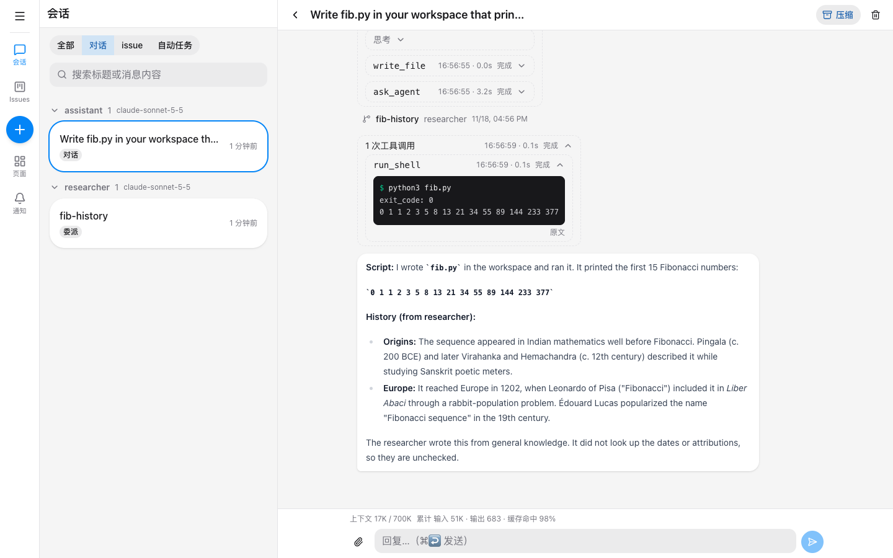
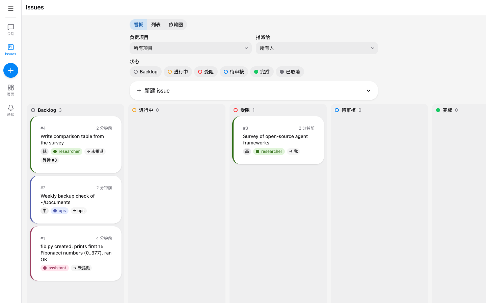
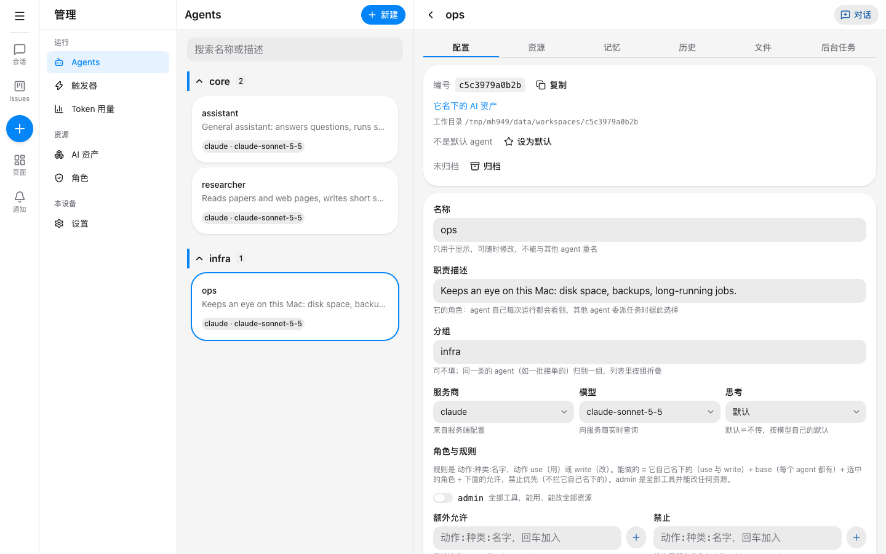
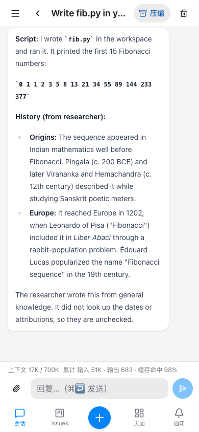

# muliao

**A self-hosted, single-user platform for running a team of long-lived AI agents on your own Mac.**

[中文](README.zh-CN.md) · [Documentation](#documentation) · [License: MIT](LICENSE)

You talk to your agents from a web UI (desktop browser or an iPhone home-screen app), hand them work, and watch them do it.
Each agent has its own description, memory, skills, workspace and schedule. Agents run real shell commands, read and edit files,
delegate to each other, wake themselves up on timers or external events, and coordinate on a shared issue board.
Everything is persisted step by step, so a restart never loses or repeats work.



## Features

- **Many agents, one owner.** Create as many agents as you like, each with a role, a model and its own working directory. Only one human user; the design trades multi-tenancy for simplicity.
- **Real tools.** `run_shell` (foreground or background jobs), `read_file` / `write_file` / `edit_file`, skill scripts that can require your approval, web search and fetch, MCP servers, file sharing, push notifications, multiple-choice questions to you.
- **Delegation.** Agents hand tasks to each other in named threads, either fire-and-forget or waiting for the answer.
- **Issue board.** Issues with owners, assignees, priorities and dependency graphs. Each issue gets a dedicated session per agent; new activity is delivered there, finished work goes to you for review (approve / send back, also from the notification).
- **Triggers.** Cron schedules, one-shot times and long-running stream commands (one event per output line), with cheap prechecks that only wake an agent when something actually happened.
- **Memory and skills as plain files.** Memories, skills, MCP configs, secrets, agent configs and roles all live under one assets directory. Edit them in the UI, with your editor, or let agents edit them; changes apply on the next run.
- **Roles and permissions.** Rules like `use:skill:deploy-*` or `write:path:~/projects/x` decide which tools, skills, MCP servers, secrets and memories each agent gets. Agent commands run in a macOS write sandbox limited to what they are allowed to write.
- **Secrets vault.** Encrypted secrets injected as environment variables and masked in output. Secrets can also be locked with your passkey (decrypted in your browser only when you approve), restricted to skill scripts, or be sign-only key pairs whose private key is never revealed, e.g. for short-lived SSH certificates or Ethereum and Solana transactions and messages.
- **Durable runs.** Every model reply and tool result is saved before moving on. After a crash or restart, sessions resume from the last step; interrupted tool calls are not re-executed blindly, the agent is told to verify first. Transient network failures are retried with backoff for up to ~30 minutes.
- **Model providers.** Anthropic Messages and OpenAI Responses protocols (and compatible services), streaming, images, prompt-cache-friendly context, automatic context compaction, per-provider concurrency limits, token usage accounting.
- **Mobile.** Installable PWA with Web Push notifications, voice input (speech-to-text), and agent-built pages you can open inside the UI.
- **Work history.** Append-only log of what each agent did, daily activity overviews, and a timeline reader agents can use to review past sessions.

| Issue board | Agent settings | Phone |
|---|---|---|
|  |  |  |

## Status and limitations

muliao is a personal project that its author uses every day; it is shared as-is.

- **macOS only.** It relies on launchd, `sandbox-exec` and a Mach-O single-file launcher. The scripts assume an Apple Silicon Mac with Homebrew in `/opt/homebrew`.
- **Single user.** One password, one data directory. There is no account system.
- **Chinese-first interface.** The web UI, tool descriptions and agent instructions are written in Chinese. Agents answer in whatever language you and their memories ask for.
- **Build from source.** There are no prebuilt binaries yet; installing compiles the project (a few minutes).
- **Not a security boundary.** Agents run commands as your macOS user. The sandbox restricts *writes*, not reads or network access; permissions exist to prevent mistakes and keep context small, not to contain a hostile agent. Only give agents secrets and machines you would trust them with. See [SECURITY.md](SECURITY.md).

## Quick start

Prerequisites: an Apple Silicon Mac, Xcode command line tools, [Homebrew](https://brew.sh), Node.js, OpenSSL,
JDK 25 and sbt from [SDKMAN!](https://sdkman.io), and [`rcodesign`](https://github.com/indygreg/apple-platform-rs).

```zsh
brew install node openssl@3 rust
curl -s "https://get.sdkman.io" | bash          # then open a new terminal
sdk install java 25.0.5.0+8-tem && sdk install sbt   # or a newer 25.x Temurin from `sdk list java`
cargo install --locked apple-codesign             # provides rcodesign
echo 'export PATH="$HOME/.cargo/bin:$PATH"' >> ~/.zprofile && export PATH="$HOME/.cargo/bin:$PATH"

git clone https://github.com/liewhite/muliaos.git && cd muliaos
mkdir -p ~/.muliao-scala
cp deploy/config.example.toml ~/.muliao-scala/config.toml
chmod 600 ~/.muliao-scala/config.toml
$EDITOR ~/.muliao-scala/config.toml               # replace every CHANGE ME, set your time zone

sh deploy/install.sh                              # build, sign and install the single-file program
sh deploy/service.sh install                      # register and start the launchd service
sh deploy/selfcheck.sh                            # verify it is up (takes about a minute)
open http://127.0.0.1:1080
```

Log in with the password from the config, open the menu (☰) → **Agents** → **新建** (New) and create your first agent, then start a conversation with it.
The full walkthrough, including HTTPS access from your phone, updates and rollback, is in [Getting started](docs/en/getting-started.md).

## Documentation

| | |
|---|---|
| [Getting started](docs/en/getting-started.md) | Install, first agent, phone access, upgrade, rollback, uninstall |
| [Concepts](docs/en/concepts.md) | Agents, sessions and runs, tools, delegation, issues, triggers, memory, skills, roles, secrets |
| [Configuration](docs/en/configuration.md) | Every `config.toml` key and the layout of the data and assets directories |
| [Architecture](docs/en/architecture.md) | Modules, dependency direction, persistence and recovery, packaging |
| [Contributing](CONTRIBUTING.md) | Building, testing and the development workflow |
| [Security policy](SECURITY.md) | Reporting vulnerabilities, what muliao does and does not protect |

The design documents the project is built against are in Chinese: [requirements](docs/requirements.md),
[stack and conventions](docs/stack.md), [frontend](docs/web.md).

## License

[MIT](LICENSE)
