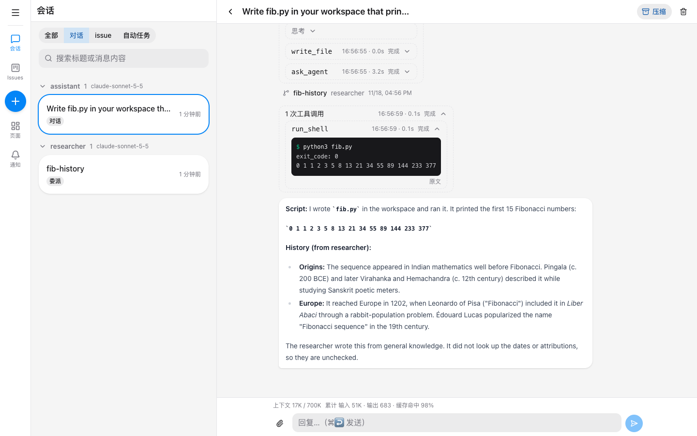
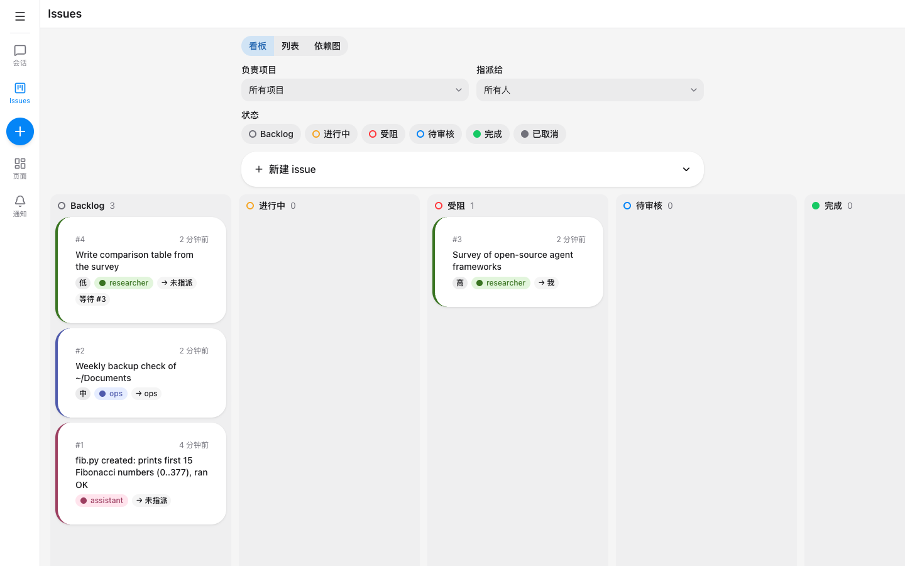
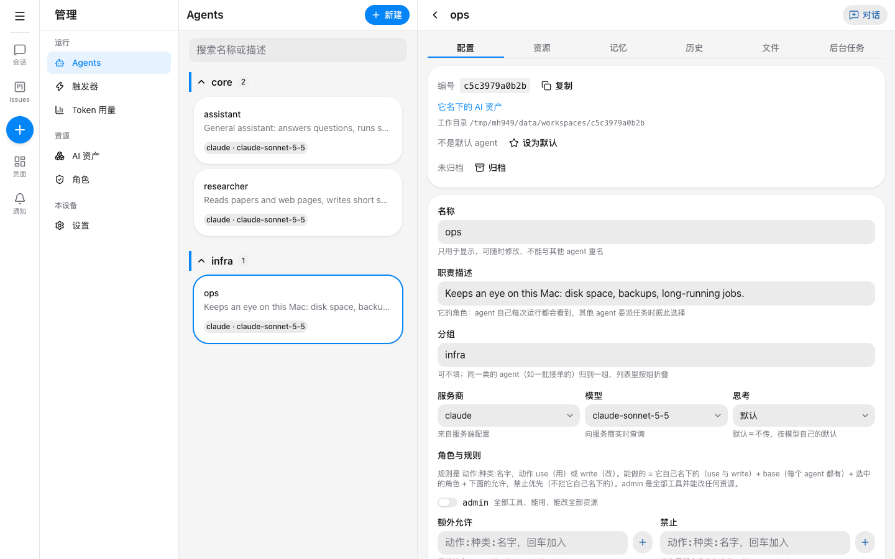
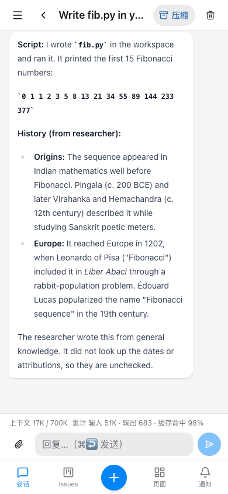

# muliao

**跑在你自己 Mac 上的个人多 agent 平台：自托管、单用户，养一队长期在岗的 AI agent。**

[English](README.md) · [文档](docs/README.md) · [许可证：MIT](LICENSE)

你在网页上（电脑浏览器，或添加到 iPhone 主屏的应用）和 agent 对话、派活、看它们干活。
每个 agent 有自己的描述、记忆、skill、工作目录和定时任务；它们能执行真实的 shell 命令、读写文件、互相委派、
按时间或外部事件自己醒来，并在共用的 issue 看板上协作。每一步都落库，服务重启不丢活、不重复做。



## 功能

- **多个 agent，一个主人。** agent 想建几个建几个，各自有角色、模型、思考档位和工作目录。只有一个用户：用多租户换来架构简单。
- **真实的工具。** `run_shell`（前台或后台任务）、`read_file` / `write_file` / `edit_file`、可要求你批准的 skill 脚本、网页搜索与抓取、MCP server、给你发文件、推送通知、向你提选择题。
- **委派。** agent 之间按具名 thread 交活，可以不等结果，也可以等对方回答。
- **issue 看板。** issue 有负责人（owner）、指派人、优先级和依赖关系图。每个 issue 对每个 agent 有一个专门的会话，新动态投到那里；做完交给你审核（通过 / 打回，通知里也能直接点）。
- **触发器。** cron 定时、一次性定时、常驻流命令（输出每行一个事件），可加便宜的前置检查，真有事才唤醒 agent。
- **记忆和 skill 就是普通文件。** 记忆、skill、MCP 配置、secret、agent 配置和角色都在一个资源目录下。可以在界面上改、用编辑器改，也可以让 agent 自己改，下次运行生效。
- **角色与权限。** `use:skill:deploy-*`、`write:path:~/projects/x` 这样的规则决定每个 agent 拿到哪些工具、skill、MCP、secret 和记忆。agent 的命令跑在 macOS 写沙箱里，只能写它被允许写的地方。
- **secret 保险库。** 加密保存，作为环境变量注入命令，输出里自动打码。secret 还可以用你的 passkey 加密（只在你批准时在浏览器里解开），或设成签名钥匙（私钥不出浏览器，比如签 SSH 短期证书）。
- **运行可恢复。** 每次模型回复、每批工具结果先落库再往下走。崩溃或重启后会话从上一步接着跑；被打断的工具调用不会盲目重做，而是让 agent 先核实。网络暂时性失败退避重试约 30 分钟。
- **模型服务商。** 支持 Anthropic Messages 与 OpenAI Responses 协议（及兼容服务）：流式输出、思考档位、图片、命中提示缓存的上下文布局、自动压缩上下文、按服务商限并发、token 用量记账。
- **手机上也好用。** 可安装的 PWA，Web Push 推送，语音输入（转文字），agent 自己做的网页可在界面里打开。
- **工作历史。** agent 做过什么的只追加记录、按天的活动回顾，以及 agent 用来回看旧会话的时间线读取工具。

| issue 看板 | agent 设置 | 手机 |
|---|---|---|
|  |  |  |

## 现状与限制

muliao 是作者每天在用的个人项目，按现状分享。

- **只支持 macOS。** 依赖 launchd、`sandbox-exec` 和 Mach-O 单文件启动器；脚本默认是 Apple Silicon、Homebrew 装在 `/opt/homebrew`。
- **单用户。** 一个密码、一份数据目录，没有账号体系。
- **界面以中文为主。** 网页界面、工具说明和给 agent 的固定说明都是中文；agent 用什么语言回答取决于你和它的记忆怎么要求。
- **从源码构建。** 暂时没有预编译的程序，安装时要编译（几分钟）。
- **不是安全边界。** agent 以你的 macOS 用户身份跑命令。沙箱只限制「写」，不限制读和网络；权限是防误操作、省上下文用的，不是用来关住恶意 agent 的。只把你信得过的 secret 和机器交给 agent。见 [SECURITY.md](SECURITY.md)。

## 快速开始

需要：Apple Silicon 的 Mac、Xcode 命令行工具、[Homebrew](https://brew.sh)、Node.js、OpenSSL、
[SDKMAN!](https://sdkman.io) 装的 JDK 25 和 sbt、[`rcodesign`](https://github.com/indygreg/apple-platform-rs)。

```zsh
brew install node openssl@3 rust
curl -s "https://get.sdkman.io" | bash          # 装完开一个新终端
sdk install java 25.0.3-tem && sdk install sbt
cargo install --locked apple-codesign             # 提供 rcodesign

git clone https://github.com/liewhite/muliaos.git && cd muliaos
mkdir -p ~/.muliao-scala
cp deploy/config.example.toml ~/.muliao-scala/config.toml
chmod 600 ~/.muliao-scala/config.toml
$EDITOR ~/.muliao-scala/config.toml               # 填登录密码、cookie_secret、vault 主密钥、模型 API key

sh deploy/install.sh                              # 编译、签名、安装成单文件程序
sh deploy/service.sh install                      # 注册并启动 launchd 服务
sh deploy/selfcheck.sh                            # 确认服务正常（约一分钟）
open http://127.0.0.1:1080
```

用配置里的密码登录，打开菜单（☰）→「Agents」→「新建」建第一个 agent，然后和它开始对话。
完整步骤（含手机经 HTTPS 访问、升级与回滚）见 [快速上手](docs/zh-CN/getting-started.md)。

## 文档

| | |
|---|---|
| [快速上手](docs/zh-CN/getting-started.md) | 安装、第一个 agent、手机访问、升级、回滚、卸载 |
| [核心概念](docs/zh-CN/concepts.md) | agent、会话与运行、工具、委派、看板、触发器、记忆、skill、角色、secret |
| [配置](docs/zh-CN/configuration.md) | `config.toml` 的每个键，数据目录与资源目录的结构 |
| [架构](docs/zh-CN/architecture.md) | 模块与依赖方向、持久化与恢复、打包 |
| [参与开发](CONTRIBUTING.md) | 构建、测试与开发流程 |

项目据以开发的设计文档：[需求](docs/requirements.md)、[技术栈与开发约定](docs/stack.md)、[前端](docs/web.md)。

## 技术栈

Scala 3 · ZIO 2 · tapir + zio-http · SQLite（ProtoQuill、Flyway）· Scala.js + Laminar · MCP Java SDK · jlink

## 许可证

[MIT](LICENSE)
